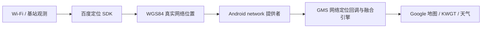

# Location Bridge · 百度网络定位桥接

将百度 SDK 获取的真实 Wi-Fi / 基站位置接入 Android 系统网络定位与官方 GMS 融合定位，让地图和天气应用在室内也能使用位置。

目前提供两个**针对实际系统与 GMS 版本验证的实验性适配**。需要 Root 和 Vector；不能仅靠 Shizuku 使用，也不能当作适用于任意 Android 14 / 17 的通用模块。

| 下载版本 | 目标手机与系统 | GMS 版本 | 对应工程 |
| --- | --- | --- | --- |
| [Pixel Android 17 · 0.5.3-public](https://github.com/lichen813-gif/location-bridge/releases/tag/v0.5.3-public) | Pixel 10 Pro XL / mustang，Android 17 `CP3A.261005.005` | `26.41.63` / `264163035`，指定 APK 指纹 | [pixel-android17](variants/pixel-android17) |
| [Q25 Android 14 · 0.6.1-public](https://github.com/lichen813-gif/location-bridge/releases/tag/v0.6.1-public) | Zinwa Q25 / Xelex Q25，Android 14 `UP1A.231005.007`，指定系统指纹 | `26.40.32` / `264032029`，指定 APK 指纹 | [q25-android14](variants/q25-android14) |

**公开 APK 不内置任何开发者的百度 AK。** 安装后需要自己申请 Android 定位 AK，在应用内保存并同意定位数据处理。两套 APK 都是 ARM64，包名相同 `io.github.lichen.locationbridge`，应按设备选用。

## 开始使用

1. 阅读[兼容范围](docs/COMPATIBILITY.zh-CN.md)，核对手机、系统、GMS 和 Vector。
2. 从对应 Release 下载 APK 和同名 `.apk.json` 校验文件。
3. 按[详细安装使用说明](docs/INSTALLATION.zh-CN.md)完成检查、安装、填写 AK、启用作用域和重启验证。
4. 日常无需反复打开桥接；由系统定位请求驱动。Google 天气的数据请求仍需正常访问 Google 服务。

## 测试范围

原始 Pixel 0.5.2、Q25 0.6.0 已分别完成真机室内定位、GMS 回调、Google 地图与 KWGT 测试，并验证重启后桥接恢复。Pixel 另已验证独立 Google 天气；Q25 没有安装该独立应用。

公开预览版增加了用户自行填写/清除 AK、撤销百度定位授权及设置变化后的提供者状态同步，保持原系统与 GMS 适配逻辑。**公开版 APK 尚未在两台手机上进行完整安装与重启回归**；已完成双版本构建签名、源码/安装包隐私检查，以及 Pixel 上不安装应用的真机内存检查。详见[验证记录](docs/VALIDATION.zh-CN.md)。

## 原理与数据

保留原 GMS 请求和回调、原 GPS 提供者及 Google 账户。拒绝过期、重复、模拟标记和非法的位置；不通过刷新旧位置时间戳制造新定位。适配只加载到用户 0 的系统和 GMS，地图、KWGT 本身不加载本模块。

定位会向百度发送定位所需的 Wi-Fi、基站及相关位置信息。AK 在本应用的私有设置中保存，诊断状态不输出 AK 或坐标。应用可清除 AK 并停止百度定位；完整恢复原系统网络提供者请按文档停用模块。

## 开发与文件

- [源码构建](docs/BUILDING.zh-CN.md)：JDK、SDK、依赖校验、签名与自己的 AK。
- [结构与适配](docs/ARCHITECTURE.zh-CN.md)：两条通道、版本保护与请求周期。
- [停用与常见问题](docs/INSTALLATION.zh-CN.md#停用与恢复)。
- [第三方组件](THIRD_PARTY_NOTICES.md)：百度 SDK、libxposed、OkHttp、Okio、Kotlin 等。

仓库沿用 [GPL-3.0](LICENSE) 许可证；第三方组件及定位服务按各自上游许可和服务条款使用。仓库不包含开发者 AK、签名私钥、手机数据库、原始定位日志、GMS APK 或反编译文件。
