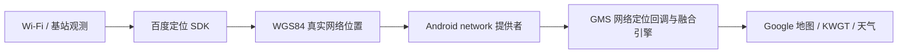

# Location Bridge · 百度网络定位桥接

将百度 SDK 获取的真实 Wi-Fi / 基站位置接入 Android 系统网络定位与官方 GMS 融合定位，让地图和天气应用在室内也能使用位置。

目前提供两个**针对实际系统与 GMS 版本验证的实验性适配**。需要 Root 和 Vector；不能仅靠 Shizuku 使用，也不能当作适用于任意 Android 14 / 17 的通用模块。

| 下载版本 | 目标手机与系统 | GMS 版本 | 对应工程 |
| --- | --- | --- | --- |
| [Pixel Android 17 · 0.5.3-public](https://github.com/lichen813-gif/location-bridge/releases/tag/v0.5.3-public) | Pixel 10 Pro XL / mustang，Android 17 `CP3A.261005.005` | `26.41.63` / `264163035`，指定 APK 指纹 | [pixel-android17](variants/pixel-android17) |
| [Q25 Android 14 · 0.6.1-public](https://github.com/lichen813-gif/location-bridge/releases/tag/v0.6.1-public) | Zinwa Q25 / Xelex Q25，Android 14 `UP1A.231005.007`，指定系统指纹 | `26.40.32` / `264032029`，指定 APK 指纹 | [q25-android14](variants/q25-android14) |

**公开 APK 不内置任何开发者的百度 AK。** 安装后需要自己申请 Android 定位 AK，在应用内保存并同意定位数据处理。两套 APK 都是 ARM64，包名相同 `io.github.lichen.locationbridge`，应按设备选用。

## 开始使用

1. 阅读[兼容范围](docs/COMPATIBILITY.zh-CN.md)，核对手机、系统、GMS 和 Vector。
2. 从对应 Release 下载 APK 和同名 `.apk.json` 校验文件。
3. 按下文[申请百度 AK](#申请百度-ak)，再按[详细安装使用说明](docs/INSTALLATION.zh-CN.md)完成检查、安装、填写 AK、启用作用域和重启验证。
4. 日常无需反复打开桥接；由系统定位请求驱动。Google 天气的数据请求仍需正常访问 Google 服务。

## 申请百度 AK

每位使用者在自己的百度账号下申请 **Android 定位 SDK 的 AK**，再填入桥接应用。使用本仓库已签名的 Release APK 时，无需安装 Android Studio、编译代码或上传签名私钥。

### 1. 登录并创建 Android 应用

1. 打开[百度地图开放平台控制台](https://lbsyun.baidu.com/apiconsole/key)，注册或登录自己的百度账号。
2. 首次使用时，按控制台提示完成开发者注册及个人/企业认证。参考官方[使用准备](https://lbsyun.baidu.com/docs/guide?title=android-guide/prepare)。
3. 进入“应用管理 → 我的应用”，点击“创建应用”。
4. 按下表填写。控制台不同页面可能将 Android 类型显示为“Android 应用”或“Android SDK”，选择 Android 客户端对应项。

| 字段 | 填写内容 |
| --- | --- |
| 应用名称 | 自行命名，例如 `location_bridge`，便于在控制台管理 |
| 应用类型 | **Android 应用 / Android SDK** |
| 启用服务 | 确保勾选 **Android 定位 SDK**；本桥接不需要额外启用地图渲染、导航或百度天气查询 |
| PackageName / 包名 | `io.github.lichen.locationbridge` |
| 发布版 SHA1 | 复制下方的 Release 签名 SHA1 |
| 开发版 SHA1 | 使用本仓库同一个已签名 APK 测试时，填写相同的 SHA1 |

### 2. 复制包名和签名 SHA1

**包名：**

```text
io.github.lichen.locationbridge
```

**本仓库当前两个 Release APK 的签名证书 SHA1：**

```text
0D:1D:3F:FE:3E:FC:ED:4E:95:3A:4A:A7:76:41:83:26:80:62:88:33
```

Pixel 与 Q25 两个发布包的包名和签名相同，这两项填写信息相同。这里的 SHA1 是**桥接 APK 的签名证书指纹**；不要填手机序列号、系统指纹、APK 文件的 SHA256，也不要填 Google 地图或 GMS 的包名。

如果控制台显示自动生成的“安全码”，核对其内容为以下 `SHA1;包名` 组合，中间是英文分号：

```text
0D:1D:3F:FE:3E:FC:ED:4E:95:3A:4A:A7:76:41:83:26:80:62:88:33;io.github.lichen.locationbridge
```

**自行构建或重新签名的 APK 必须使用实际签名证书的 SHA1**，不能直接沿用上面的值。可查看构建生成的 `.apk.signature.txt` 中 `certificate SHA-1 digest`，或者使用 Android SDK Build-Tools 的 `apksigner verify --print-certs` 检查 APK。参考[源码构建说明](docs/BUILDING.zh-CN.md)。

### 3. 提交申请并填入桥接

1. 核对应用类型、定位服务、包名及 SHA1，按页面要求阅读服务条款并提交。
2. 返回“我的应用”，找到刚创建的应用，复制其 **AK / 访问应用（AK）**。不要把应用编号、证书 SHA1 或上面的安全码当作 AK。参考官方[注册和获取密钥](https://lbs.baidu.com/docs/guide?title=android-guide/create-project/ak)。
3. 按[安装说明](docs/INSTALLATION.zh-CN.md)安装对应版本，在手机上打开“定位桥接”或“定位桥接 Q25”，将 AK 粘贴进输入框。本公开版要求 AK 为 32 位英文字母或数字。
4. 阅读并勾选定位数据处理授权，点击“保存 AK 和使用授权”。AK 保存在桥接应用的私有设置中，不需要写入源码或重新打包 APK。
5. 确认系统定位与定位权限已开启、网络正常，点击“开始两分钟室内测试”。取得新的网络位置后，再按安装说明完成 Vector 作用域、重启及地图/天气验证。**保存成功只代表本地保存完成，不代表百度鉴权已经通过。**

### 申请或鉴权遇到问题

| 情况 | 处理方法 |
| --- | --- |
| 已有 AK，但类型为浏览器或服务端 | 为本桥接另建 Android 类型的 AK |
| 鉴权失败或没有定位服务权限 | 在控制台打开该应用的设置，核对 Android 定位 SDK 已启用、包名及实际 APK 签名 SHA1 一致 |
| 重新签名后原 AK 失效 | 用新证书的 SHA1 更新对应申请信息；开发和发布使用不同签名时分别填写 |
| 想在 Google 天气或 KWGT 中使用 | AK 填在桥接应用内；它负责位置来源，天气内容仍由各应用自己的天气提供商获取 |
| 额度不足或控制台要求额外开通 | 按自己的账号、使用场景和控制台当前规则处理，本项目不承诺固定免费额度 |

请保管自己的 AK，不要贴到公开 issue、README、截图或日志中。完整的平台申请说明见[官方定位 SDK 密钥文档](https://lbsyun.baidu.com/index.php?title=模板:Android定位SDK注册和获取密钥)。

## 测试范围

原始 Pixel 0.5.2、Q25 0.6.0 已分别完成真机室内定位、GMS 回调、Google 地图与 KWGT 测试，并验证重启后桥接恢复。Pixel 另已验证独立 Google 天气；Q25 没有安装该独立应用。

公开预览版增加了用户自行填写/清除 AK、撤销百度定位授权及设置变化后的提供者状态同步，保持原系统与 GMS 适配逻辑。**公开版 APK 尚未在两台手机上进行完整安装与重启回归**；已完成双版本构建签名、源码/安装包隐私检查，以及 Pixel 上不安装应用的真机内存检查。详见[验证记录](docs/VALIDATION.zh-CN.md)。

## 原理与数据



保留原 GMS 请求和回调、原 GPS 提供者及 Google 账户。拒绝过期、重复、模拟标记和非法的位置；不通过刷新旧位置时间戳制造新定位。适配只加载到用户 0 的系统和 GMS，地图、KWGT 本身不加载本模块。

定位会向百度发送定位所需的 Wi-Fi、基站及相关位置信息。AK 在本应用的私有设置中保存，诊断状态不输出 AK 或坐标。应用可清除 AK 并停止百度定位；完整恢复原系统网络提供者请按文档停用模块。

## 开发与文件

- [源码构建](docs/BUILDING.zh-CN.md)：JDK、SDK、依赖校验、签名与自己的 AK。
- [结构与适配](docs/ARCHITECTURE.zh-CN.md)：两条通道、版本保护与请求周期。
- [停用与常见问题](docs/INSTALLATION.zh-CN.md#停用与恢复)。
- [第三方组件](THIRD_PARTY_NOTICES.md)：百度 SDK、libxposed、OkHttp、Okio、Kotlin 等。

仓库沿用 [GPL-3.0](LICENSE) 许可证；第三方组件及定位服务按各自上游许可和服务条款使用。仓库不包含开发者 AK、签名私钥、手机数据库、原始定位日志、GMS APK 或反编译文件。
